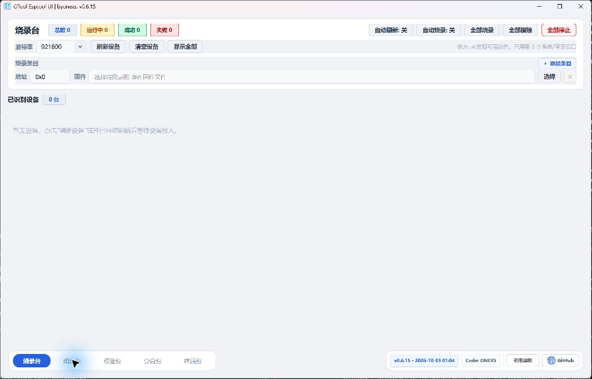
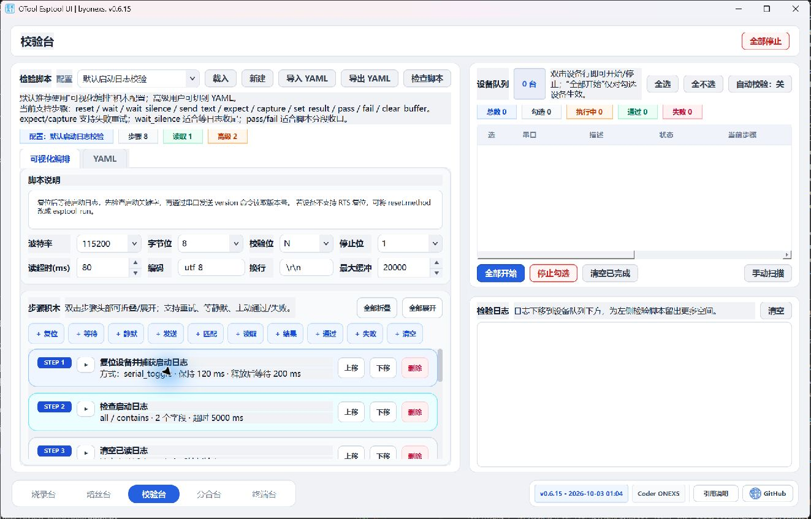
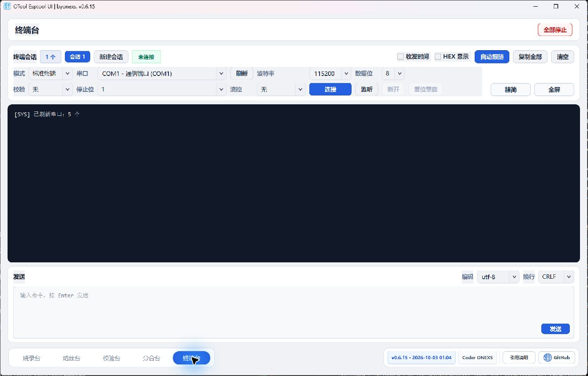
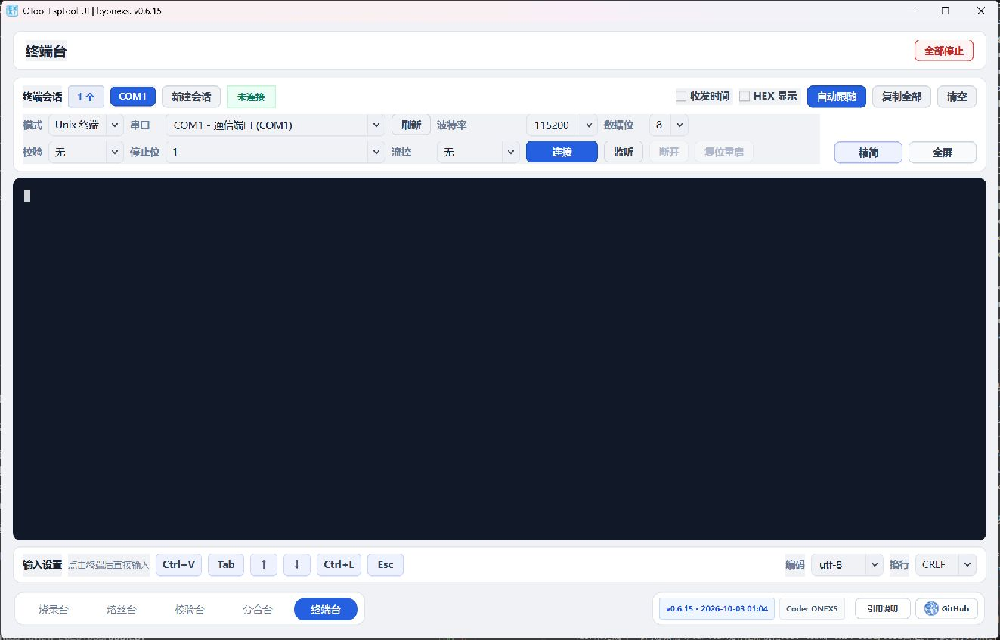

# OTool Esptool UI

> ESP 烧录 / eFuse / 串口校验 / 固件分合 / 多会话终端 · v0.6.23

OTool Esptool UI 是面向 Windows 的 ESP 桌面工作台，基于 PyQt6 与 esptool，提供五个工作台和可独立运行的单文件 EXE。多设备任务共享串口占用管理，避免不同工作台同时打开同一个串口。



## 五个工作台

### 烧录台

- 扫描串口，以设备卡片显示芯片、MAC、Flash 容量等信息；默认过滤系统和蓝牙串口，可切换“显示全部”。
- 支持单台或批量识别、擦除、烧录、停止，以及整片或指定范围 Flash 导出。
- 多条目烧录支持地址与固件配对；执行前检查文件可读性、空文件、32 位地址范围和 4 KiB 擦除扇区重叠。
- 固件名尾部地址（例如 `firmware_0x10000.bin`）可自动填入；可扫描固件目录并选择最新文件。
- 固件行的“选择”菜单支持 bin 文件和 ESP-IDF build 目录，也可粘贴目录路径后按回车或移开焦点导入。build 需包含 `flasher_args.json`；成功导入会替换整个清单，按地址展开为可编辑条目，并带入芯片、Flash 和复位/stub 参数。取消或导入失败会保留原配置。
- “选择”菜单的分界线下显示最近使用记录，bin 与 build 合计最多 16 条，最近使用的排在前面，重启后保留。历史项区分类型，长路径以六个星号省略中间，优先保留末尾目录与文件名；悬停显示完整路径。已不存在的条目禁用，选择 build 历史时会重新读取当前构建清单。
- 导入后的“恢复默认参数”仅清除项目参数，保留镜像条目。重新编译后仍会读取当前文件内容；文件清单、地址或参数变化时需重新导入。项目指定芯片时，芯片不匹配会终止烧录。
- 自动烧录需手动开启；连接和芯片检测默认限时 3 秒，连接超时或烧录失败后等待 10 秒自动重试。成功后提示拔出设备，按 3 秒定时器实际读取芯片信息与 MAC；USB 转串口仍在线不代表芯片在线。连续两次无芯片响应后确认移除；串口被占用或工具异常不会误判离线。确认后提示“已就绪，等待下一台设备接入”，继续读取下一台芯片后才进入下一轮。完成卡片和日志保留并复用，设备仅改变 COM 号不会立即重复烧录。
- 顶部“显示历史”打开右侧设备历史栏，初始关闭，记住上次开关状态。按 MAC 汇总设备，型号右侧同行显示完整 MAC；未识别记录默认隐藏，右下角可勾选“显示全部”查看，原记录继续保留。紧凑卡片记录每次烧录开始时间、结果、总耗时和各阶段耗时，支持搜索与展开明细；彩色分段耗时条按实际耗时占比显示，悬停查看阶段数值。手动烧录、全局和单串口自动烧录使用同一记录流程，每次重试单独记录；等待拔出和重试等待不计入耗时。历史保存在本地 flash_history.json，保留最近 1000 次。
- Python 完整版：双击根目录“启动程序.cmd”，或运行 `.venv\Scripts\python.exe otool_esptool_ui.py`。五个工作台均连接实际功能，历史栏只显示本机真实记录；没有记录时显示空状态。芯片存在检测采用 read-mac，会进入 ROM 连接流程并复位，但不会擦除或写入固件。
- 等待重试期间可点击卡片“停止”；关闭对应自动模式、屏蔽或断开设备会取消重试。成功后的移除检测同样受自动开关、屏蔽和停止控制；串口扫描失败不会误判为设备已移除。项目芯片不匹配仍会终止，不会改写指定芯片；连接检测的 3 秒限制不影响后续擦除、写入和校验。
- 设备名悬停显示全称，端口号仅在 COM 徽标显示；长名称以六个星号省略中间，优先保留末尾型号词。
- 点击设备名前的三横线菜单，或右键名称/菜单图标，可按端口或设备屏蔽；再次取消对应复选项即可解除。屏蔽设备保留卡片，显示灰底白字 `BLOCK` 角标，卡片操作禁用，并退出自动/批量烧录、校验、熔丝及终端重连。
- 屏蔽规则保存在本机配置目录 `OTool/EsptoolUI/device_policies.json`，重启仍生效。按端口规则绑定 COM 口；按设备规则优先使用 USB 序列号，缺失时使用 VID/PID 与连接位置；没有唯一标识时退回当前端口，菜单会提示。
- 设备菜单的“自动烧录”可独立勾选，只对当前串口生效，显示紫底白字 `AUTO` 角标，并开启自动刷新。勾选后会按当前固件配置尝试启动该设备，后续该口新接入设备沿用原自动烧录流程；取消会撤销该口等待中的自动触发。此勾选仅在本次运行有效，屏蔽优先。
- 显示结构化进度、操作日志和最终结果，刷新设备不会将已完成结果改回空闲。

### 熔丝台


- 选择芯片型号，手动编辑字段，或导入 `burn_efuse_fields` / `efuse_presets` YAML 配置。
- 按设备执行读取、预检、烧写和校验流程，显示各设备状态与错误原因。
- 已满足的字段可跳过；缺失字段、不可读数据、写保护冲突、位宽错误及不允许的 OTP 位变化会阻止烧写。
- 强制重试仍受字段与 OTP 安全检查约束，不表示可以撤销已烧写的位。
- 单设备 eFuse 对话框支持字段搜索、已熔丝筛选、JSON summary 和预设字段；右键快捷入口先预填并确认。
- eFuse 烧写不可逆，执行中禁止强制终止。单设备烧写完成后需重新读取核验。

### 校验台



- 可视化步骤编排与 YAML 双视图，支持导入、导出、检查脚本和步骤折叠。
- 支持 `reset`、`wait`、`wait_silence`、`send_text`、`expect`、`capture`、`set_result`、`pass`、`fail`、`clear_buffer`。
- 按包含文本或正则匹配启动日志，使用 all / any / none 条件；可提取参数并组合结果摘要。
- 配置步骤超时、失败重试、串口编码、换行和缓冲上限；增量处理分片中文与 CRLF。
- 设备勾选队列、自动校验、单台开始/停止、批量操作和日志统计。

### 分合台


图中使用本地生成的离线 LittleFS 演示镜像，不含设备数据。

- 分析合并固件中的分区表，提取 bootloader、分区表和分区原始数据；保留合法的尾部 `0xFF`。
- 按地址合并多份固件，支持 raw BIN、Intel HEX、UF2；检查范围重叠和输出覆盖输入。
- 合并成功的 raw BIN 可发送到烧录台；HEX/UF2 不作为原始二进制烧录条目传递。
- 显示可复制的 MD5、SHA-1、SHA-256；支持从设备读取镜像后分析。
- **LittleFS 文件浏览**：只读挂载、目录浏览和文件提取，保留子目录结构；挂载失败不会格式化镜像副本或显示伪成功。
- FAT / SPIFFS 支持分区识别与原始分区提取，**不支持内部文件浏览**。加密、损坏或参数不匹配的镜像不保证可解析。

### 终端台



- 多会话串口终端，支持标准终端、文本终端与 Unix 终端模式。
- 配置波特率、数据位、校验、停止位、流控、编码与换行；文本/HEX 收发、时间戳、日志筛选和导出。
- Unix 模式默认“自动”：Enter 和多行粘贴换行发送单个 CR，避免串口 Shell 将 CRLF 当作两次提交；标准/文本模式默认 CRLF。
- 各会话分别记住每种模式的换行选择；可手动选择 LF、CRLF、CR 或不追加。“自动”按模式选择输入换行，不探测设备回显。
- 支持监听、断线重连、快捷发送和复位；后台会话重连不切走当前会话。
- 发送处理部分写入，连续发送时仍保留接收机会。
- 精简模式隐藏应用外壳；全屏可独立切换。



该图为 0.6.15 界面示例；从 0.6.16 起，Unix 模式默认换行为“自动”（单个 CR）。

Unix 模式提供 ANSI/VT 屏幕仿真、方向键和控制键、直接键盘输入与粘贴，适合串口 Shell。它不是本机命令行，也不是 SSH 客户端；设备端需要提供对应串口服务。

## 界面与配置

- 小屏或高 DPI 下工作区自动提供滚动，底部导航保持可见；窄窗口下导航与版本信息分两行。
- “引用说明”显示实际组件版本、上游发布日期和来源；无需联网即可查看构建清单。
- `config.yaml` 保存 eFuse 预设与 `verify_profiles`；示例见 `esp32p4_burn_efuse_config_example.yaml`。
- 源码运行时读取项目内配置；单文件 EXE 使用构建时嵌入的默认配置；校验台优先读取 EXE 旁的 `config.yaml`，运行中也可通过界面导入 YAML。
- 默认查找程序附近的 `firmware` 目录；可使用 `OTOOL_ESPTOOL_UI_FIRMWARE_DIR` 指定固件目录。
- Windows 任务栏快捷任务可进入烧录、分合、标准终端或 Unix 终端；也可使用 `--tab 0..4` 与 `--terminal-mode terminal|unix|plain`。

## 源码运行

最低 Python 3.10；本次 Windows x64 发布使用 **Python 3.12.10**。锁定清单面向该构建环境。

```powershell
git clone --recurse-submodules https://github.com/onexs-xsi/otool_esptool_ui.git
cd otool_esptool_ui
python -m venv .venv
.\.venv\Scripts\python.exe -m pip install -r requirements.txt
.\.venv\Scripts\python.exe otool_esptool_ui.py
```

`esptool` 子模块固定到正式版本 v5.6.0。未初始化或不完整时使用安装环境中的 esptool；正式构建前需确保子模块和安装版本一致。普通源码运行无需 PyInstaller。

也可使用管理脚本创建/复用环境，默认 Python 版本为 3.12.10：

```powershell
.\management_tools.ps1 -Action init-env
.\management_tools.ps1 -Action run-app
```

不传参数可打开环境与打包管理界面。Python 可来自系统或脚本下载的本地工具目录；切换已有环境的 Python 版本需要明确重建环境。

## 测试与打包

```powershell
.\.venv\Scripts\python.exe -m unittest discover -s tests
.\.venv\Scripts\python.exe -m pip check
.\management_tools.ps1 -Action package -PythonVersion 3.12.10
```

- 运行清单：`requirements.txt`；构建清单：`requirements-build.txt`（包含运行依赖与 PyInstaller、hooks、setuptools、pip）。两者均锁定具体版本。
- 依赖声明维护在 `pyproject.toml`；构建清单通过同一依赖源的 `build` extra 生成。刷新清单后必须重跑回归与 EXE 检查。
- 每次构建前递增补丁版本，同步入口 `__version__`、项目元数据、README 当前版本及常量回退版本；失败后的重试同样递增。`file_version_info.txt` 由 spec 自动生成。
- 构建检查 Qt 启动、esptool / espefuse / espsecure 分发、Qt/ICU DLL 与 cryptography 原生扩展，输出 `dist/otool_esptool_ui.exe`。
- 单文件 EXE 不需要本机 Python。请保留 [第三方组件说明](THIRD_PARTY_NOTICES.md)，并按需准备固件与独立 YAML 文件。

界面矩阵可通过 `tests/ui_matrix.py` 离屏复现；它只使用模拟空串口，不访问设备。截图来自软件真实运行界面，未展示虚构烧录结果。

## 本次验证边界

本次使用自动回归、模拟串口、离线固件和实际 EXE 验证；**未连接真实 ESP 设备**。真实 USB 热插拔时序、芯片复位、Flash 擦写结果、板级串口行为及 eFuse 写后结果尚需设备验证。详细结果见 [本次检查记录](review_20261003.md)。

## Changelog

### v0.6.23

- 发布完整 Windows 单文件 EXE，包含五个工作台、真实设备历史、分阶段耗时及紧凑历史卡片。
- 内置 esptool 5.6.0，移除演示模式，保留本机历史、固件记录和屏蔽规则。

### v0.6.22

- 提供完整 Python 版本和“启动程序.cmd”双击入口；移除程序中的历史演示模式与样例数据，示例仅保留在测试目录。
- 右侧历史按 MAC 汇总，记录开始时间、总耗时和真实阶段耗时，支持搜索、悬停详情与历次记录展开；“显示历史”记住用户选择。
- 未识别记录默认隐藏，可在历史栏右下角勾选“显示全部”；型号与完整 MAC 同行显示，压缩卡片高度。
- 自动烧录完成后通过芯片信息与 MAC 确认设备是否仍在，USB 转串口在线不作为芯片在线依据；确认移除后等待下一台设备。
- 修正管理脚本启动时隐藏主窗口的问题，保留现有屏蔽规则、固件使用记录和真实烧录历史。

### v0.6.21

- 自动烧录成功后每 3 秒检测原设备，提示拔出并记录在线状态，确认移除后才准备下一轮；保留完成卡片与日志，重插后复用。
- 固件选择菜单增加分界线与最近使用记录，bin/build 合计保留 16 条，按最近使用排序并持久化；长路径以六个星号省略中间，保留目录/文件尾部，悬停显示全路径。
- 提供新的独立 Windows EXE，包含内置 esptool 5.6.0。

### v0.6.20

- 设备卡片增加菜单、持久化屏蔽、单串口自动烧录和 BLOCK / AUTO 丝带。
- 设备名称移除重复 COM 后缀，提供完整名称提示和保留尾词的六星号省略。
- 更新内置与运行依赖 esptool 至正式版 5.6.0；本次仅提供 Python 运行测试，不生成 EXE。

### v0.6.18

- Unix 终端按日志区宽度自动调整列数。拉宽、缩窄窗口或切换全屏时，已保留的串口日志同步重新排版，设备发送的换行仍然保留。
- 三种终端的日志区均支持右键复制选区、复制全部、全选、粘贴和清空。标准与文本模式将粘贴内容放入发送框，Unix 模式按当前编码和换行设置直接发送到已连接的串口。
- Unix 模式使用 Ctrl+Shift+C 复制选区，Ctrl+C 发送中断；三种模式都可用 Ctrl+V、Ctrl+Shift+V 或 Shift+Insert 从日志区粘贴。标准与文本发送框的右键菜单支持撤销、重做、剪切、复制和粘贴。

### v0.6.17

- 固件行支持选择 bin 文件、导入或粘贴 ESP-IDF build 目录，完整清单展开为可编辑条目。
- 导入构建中的芯片、Flash、复位和 stub 参数；支持恢复默认参数，导入失败时保留原配置。
- 项目指定芯片时阻止型号不匹配的烧录和自动切换型号重试。

### v0.6.16

- Unix 终端默认使用“自动”换行，Enter 与多行粘贴发送单个 CR。
- 标准/文本终端默认保持 CRLF，换行设置按会话与模式分别记忆。

### v0.6.15

- 升级 esptool 5.4.0、终端宽度计算库和构建工具，锁定运行与构建依赖。
- 适配 esp-pylib 日志代理，修复工作进程崩溃，统一 JSON 事件 UTF-8 编码。
- 修复 LittleFS 无效镜像被自动格式化后误报成功，以及有效镜像块参数探测失败。
- 修复空 esptool 子模块误判、窄窗口/高 DPI 内容不可达、编码字段裁切和引用说明窗口过大。
- 修复 EXE 下拉箭头资源路径、内置校验配置读取及后台头像刷新。
- 整合已有设备状态、任务取消、串口互斥、固件处理与校验流程修复。
- 更新五个工作台能力说明、界面截图和第三方组件清单。

### v0.2.0

- 新增「校验台」页：支持复位后启动日志校验、串口发送文本、分步骤等待与多字段匹配
- 新增 `verify_profiles` YAML 脚本格式，可在 `config.yaml` 中维护默认检验脚本
- 校验台新增可视化积木编辑器、步骤折叠、参数读取（`capture`）与结果展示（`set_result`）
- 校验台设备队列支持勾选批量开始、全选 / 全不选、双击单台开始 / 停止，日志下移优化排版
- 校验台新增 `wait_silence` / `pass` / `fail` 高级步骤，以及步骤级失败重试能力
- 校验台新增脚本摘要 / 设备状态统计胶囊，复杂脚本和多设备并跑时更易读
- 新增「熔丝台」页：批量 eFuse 烧写，支持多设备并联、热插拔、芯片型号校验
- 熔丝台字段配置：手动添加 / YAML 文件导入（burn_efuse_fields / efuse_presets 双格式）
- 强制烧写（黄色按钮）：跳过预检、对已满足字段再次执行烧录
- 各页签 toolbar 控件独立分离（烧录台/熔丝台互不干扰）
- 多条目烧录（多组地址+固件）
- 清空设备按钮
- eFuse 对话框 JSON 解析 + 5 列布局优化
- 默认窗口尺寸 ×1.2
- 提供 `esp32p4_burn_efuse_config_example.yaml` 配置示例

### v0.1.x

- 初始版本：多设备识别、擦除、烧录、自动烧录

## License

本项目源码采用 [MIT](LICENSE)。第三方依赖遵循各自许可证，详见 [THIRD_PARTY_NOTICES.md](THIRD_PARTY_NOTICES.md)。
